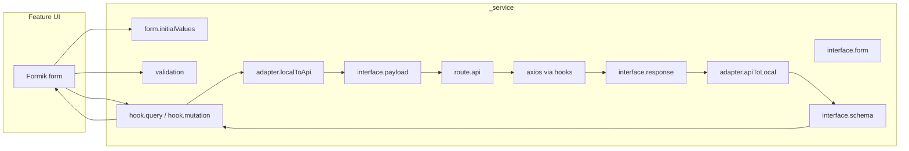

# `_service` development guide

`src/app/_service/<module>/` is the **API and data layer**: one subfolder per server module
(`auth`, `users`, `settings`, `pages`, `catalog`, `media`, `tickets`), each with the same file
layout. It holds routes, wire types, adapters, React Query hooks, Formik initial values and Yup
schemas. It does **not** hold UI — screens live in `src/features/<area>/`.

The reference module is **`tickets/`** (public + admin endpoints, form + triage).

Server components never use this layer: they fetch `/public/*` through `src/lib/server/publicApi.ts`
(native `fetch` with cache tags). `_service` is for the browser (admin panel, public forms).

---

## Layout (per module)

| File | Responsibility |
|------|----------------|
| `route.api.ts` | URL path constants and dynamic route builders (`/admin/...`, `/public/...`) |
| `interface.response.ts` | Raw backend response shapes |
| `interface.payload.ts` | Request bodies and **query-param** shapes |
| `interface.schema.ts` | Frontend **entity** types (what the app uses after adapters) |
| `interface.form.ts` | Formik **form** value types |
| `adapter.apiToLocal.ts` | Response → entity (and list/paginated wrappers) |
| `adapter.localToApi.ts` | Form/entity → request payload (drops empty locales via `cleanLocalized`) |
| `hook.query.tsx` | `useQuery` hooks for GET |
| `hook.mutation.tsx` | `useMutation` hooks for POST / PATCH / PUT / DELETE |
| `form.initialValues.ts` | Default Formik values and `get<Entity>FormInitialValue` helpers |
| `validation.ts` | Yup schemas for forms (messages are i18n keys, e.g. `validation.required`) |

`interface.response.ts` at the `_service` root only holds the shared `PaginatedResponse<T>`.

## Localized fields

Admin endpoints return every text as a `LocalizedString` map (`{ fa, en }`); public endpoints
return resolved strings. Forms edit the map with `LocalizedTextInput`; `cleanLocalized` strips
empty locales before sending so the public site falls back to the default locale.

---
## Data flow



**Mutations:** `FormSchema` → adapter → `*Payload` → API → `*Response` → adapter → `*Schema` (entity).

**Queries:** API → `*ReadResponse` → adapter → `*Schema` / `*ListSchema`.

---

## Naming rules

### URL segments → names

Build names from **static path segments** in order, in PascalCase for types/hooks and camelCase for functions/constants.

| URL | Entity prefix | Example route constant |
|-----|---------------|------------------------|
| `/ticket` | `Ticket` | `TICKET_ROUTE` |
| `/public/tickets/token` | `TicketsToken` | `TICKETS_TOKEN_ROUTE` |

**Singular vs list:** use explicit intent in the name — avoid English pluralization (`category` / `categories`).

- Single resource: `Ticket`, `TicketRead`, `useGetTicketById`
- Collection: `TicketList`, `TicketListRead`, `useGetTicketList`
- Paginated collection: `TicketPaginatedList`, `useGetTicketPaginatedList`

### `route.api.ts`

| Case | Pattern | Example |
|------|---------|---------|
| Static path | `UPPER_SNAKE`: `<SEGMENT1>_<SEGMENT2>_..._ROUTE` | `TICKETS_TOKEN_ROUTE = '/public/tickets/token'` |
| Dynamic path | camelCase: `get<Segments>RouteBy<ParamName>` | `getTicketRouteById(id)` |

- Path params only — **never** encode query strings in route builders.
- Multiple dynamic segments: append `By<Param>` in path order, e.g. `getCompanyUserRouteByCompanyIdByUserId(companyId, userId)`.
- Param names should match the API (`id`, `tokenId`, `slug`, etc.).

### `interface.response.ts`

`<Segments><Action>Response`

| HTTP | Action suffix |
|------|----------------|
| GET (one) | `Read` |
| GET (list) | `ListRead` (or `PaginatedListRead` when wrapped) |
| POST | `Create` |
| PATCH / PUT | `Update` |
| DELETE | `Delete` (only if the API returns a typed body) |

Examples: `TicketReadResponse`, `TicketListReadResponse`, `TicketCreateResponse`, `TicketPaginatedListReadResponse`.

Shared wrappers (e.g. `PaginatedResponse<T>`) stay generic here.

### `interface.payload.ts`

`<Segments><Action>Payload` for **request bodies**.

| HTTP | Action suffix |
|------|----------------|
| POST | `Create` |
| PATCH / PUT | `Update` |
| DELETE | `Delete` (only if the API expects a body) |

**Query parameters** (GET filters, pagination, sort):

- Use a dedicated type: `<Segments><Purpose>QueryPayload`
- Example: `TicketListReadQueryPayload` extending `PaginationQuery` with `limit`, `offset`
- Do **not** add these to `route.api.ts`

### `interface.schema.ts` (frontend entities)

Types the UI and hooks use **after** adapters.

| Shape | Naming |
|-------|--------|
| Single entity | `<Entity>Schema` e.g. `TicketSchema` |
| Array | `<Entity>ListSchema` e.g. `TicketListSchema` |
| Paginated list (local) | `<Entity>PaginatedListSchema` |

No HTTP verbs here — this is app domain shape, not wire format.

### `interface.form.ts` (Formik only)

`<Entity>FormSchema` — fields the form edits, which may differ from the entity (extra UI fields, different keys, optional update fields).

Do not put entity or API types in this file.

### Adapters

Pattern: **`<InputInterface>2<OutputInterface>`** (camelCase function name).

| File | Direction | Example |
|------|-----------|---------|
| `adapter.apiToLocal.ts` | Response → schema | `ticketReadResponse2TicketSchema` |
| `adapter.localToApi.ts` | Form → payload | `ticketFormSchema2TicketCreatePayload` |

For lists/paginated responses, define explicit input/output types (e.g. `TicketListReadResponse` → `TicketListSchema`) so the `2` rule still holds.

### `hook.mutation.tsx`

`use<HttpMethod><UrlSegmentsInPascalCase>[By<Dynamic>...]`

| Endpoint | Hook |
|----------|------|
| `POST /ticket` | `usePostTicket` |
| `POST /public/tickets/token` | `usePostTicketsToken` |
| `PATCH /ticket/:id` | `usePatchTicketById` |
| `DELETE /ticket/:id` | `useDeleteTicketById` |

- `mutationKey`: kebab-case mirror of the hook, e.g. `['patch-ticket-by-id']`.
- Wire adapters in `mutationFn`; mutation input is usually `TicketFormSchema` (or `{ id, payload }` when path params exist).

### `hook.query.tsx`

`useGet<UrlSegmentsInPascalCase>[List|PaginatedList][By<Dynamic>...]`

| Endpoint | Hook |
|----------|------|
| `GET /ticket/:id` | `useGetTicketById` |
| `GET /ticket` (array) | `useGetTicketList` |
| `GET /ticket?limit=&offset=` | `useGetTicketPaginatedList` |

**Query params:**

1. Accept `query?: SomeQueryPayload` on the hook.
2. Build a plain `queryParams` object for `api.get(..., queryParams)`.
3. Put **normalized** `queryParams` in `queryKey` so cache invalidation stays correct.

```ts
queryKey: ['get-ticket-paginated-list', queryParams],
```

Optional `options?: { enabled?: boolean }` for conditional fetching.

### `form.initialValues.ts`

- One helper per form when create/update share the same fields: `get<Entity>FormInitialValue(overrides?)`.
- Returns `<Entity>FormSchema`; merge defaults with `Partial<>` overrides for edit screens.
- Separate helpers only when create and update forms differ materially.

### `validation.ts`

`<entity><create|update>ValidationSchema` in camelCase.

Examples: `ticketCreateValidationSchema`, `ticketUpdateValidationSchema`.

Use separate schemas when create vs update rules differ (required fields, nullable patches, etc.). For unrelated forms (e.g. nested resource), use the full segment prefix: `ticketsTokenCreateValidationSchema`.

---

## What belongs outside `_service`

| Concern | Location |
|---------|----------|
| Pages, layouts | `src/app/<feature>/page.tsx` |
| Form UI | `src/app/<feature>/_components/` |
| Shared form inputs | `src/shared/UI/FormInputs/` |
| Axios instance, auth | `src/lib/` |

Example: [`src/features/<area>/TicketCreateForm.tsx`](../ticket/_components/TicketCreateForm.tsx) imports hooks and types from `_service` only.

---

## Pagination

Paginated list endpoints use **offset-based paging** (`limit` + `offset` query params). The backend returns a fixed envelope:

```ts
interface PaginatedResponse<T> {
  data: T[];
  total: number;
  limit: number;
  offset: number;
  total_pages: number;
}
```

| Topic | Value |
|-------|-------|
| Request params | `limit` (default 50, max 100), `offset` (default 0) |
| Page conversion | `currentPage = floor(offset / limit) + 1`; `offsetForPage = (page - 1) * limit` |
| Shared helpers | `src/lib/pagination/` — types, constants, `buildPaginationQueryParams`, navigation helpers |
| URL state | `usePagination` in `src/shared/hooks/` syncs `?offset=&limit=` via Next.js search params |
| UI | `Pagination` in `src/shared/UI/Pagination/` — reference usage in `TicketPaginatedList` |

**Client flow:** on filter change → reset `offset` to `0`; on page change → set `offset = (page - 1) * limit`; on page-size change → update `limit`, reset `offset` to `0`. Always render rows from `response.data`.

**Edge cases:**

| Situation | What to do |
|-----------|------------|
| `total === 0` | Show empty state |
| `data.length < limit` | Current page is the last page |
| `data.length === 0` but `total > 0` | Offset past end — clamp via `clampOffset` / `clampToTotal` |
| User requests page beyond `total_pages` | Clamp to last page before or after fetch |

Non-paginated list endpoints (plain arrays) keep separate hooks like `useGetTicketList`.

---

## Edge cases

| Situation | Approach |
|-----------|----------|
| **Query params** | `*QueryPayload` in `interface.payload.ts`; pass to hook and `queryKey`; not in routes |
| **Form ≠ entity** | `interface.form.ts` + `adapter.localToApi`; never reuse `*Schema` for Formik unless identical |
| **Same form for create & update** | One `*FormSchema`, one `get*FormInitialValue`, two validation schemas if rules differ |
| **DELETE with no body** | No delete payload type; hook only takes `id` |
| **Nested routes** | Include all static segments in every name (`TicketsToken`, `usePostTicketsToken`) |
| **Multiple path params** | `get*RouteByAByB`; hook `useGet*ByAByB` |
| **Paginated API** | `*PaginatedListReadResponse` → `*PaginatedListSchema`; dedicated list adapter; request uses `limit`/`offset`, response uses `{ data, total, limit, offset, total_pages }` |
| **Generic pagination wrapper** | `PaginatedResponse<T>` in `interface.response.ts`; helpers in `src/lib/pagination/` |
| **File upload** | Use `api.postFormData` from `axiosInstance`; add response/payload types and hooks as above |
| **Invalidate cache** | Match `queryKey` strings used in `hook.query.tsx` (e.g. `get-ticket-list`) |

---

## Checklist: new endpoint

1. **`route.api.ts`** — static `*_ROUTE` and/or `get*RouteBy*`.
2. **`interface.response.ts`** / **`interface.payload.ts`** — wire types (+ `*QueryPayload` if GET has params).
3. **`interface.schema.ts`** — entity (and `*ListSchema` / `*PaginatedListSchema` if needed).
4. **`interface.form.ts`** — if a form is involved.
5. **Adapters** — `*2*` functions for each conversion.
6. **`hook.query.tsx`** or **`hook.mutation.tsx`** — hook + `queryKey` / `mutationKey`.
7. **`form.initialValues.ts`** + **`validation.ts`** — for forms only.
8. **Feature UI** — consume hooks; invalidate queries on mutation success.

---

## Reference: ticket sample

| Concern | Symbol |
|---------|--------|
| Route | `TICKET_ROUTE`, `getTicketRouteById` |
| Entity | `TicketSchema`, `TicketListSchema` |
| Form | `TicketFormSchema`, `getTicketFormInitialValue` |
| Payload | `TicketCreatePayload`, `TicketListReadQueryPayload` |
| Response | `TicketReadResponse`, `TicketCreateResponse` |
| Adapters | `ticketFormSchema2TicketCreatePayload`, `ticketCreateResponse2TicketSchema` |
| Mutations | `usePostTicket`, `usePatchTicketById`, `useDeleteTicketById` |
| Queries | `useGetTicketById`, `useGetTicketList`, `useGetTicketPaginatedList` |
| Validation | `ticketCreateValidationSchema`, `ticketUpdateValidationSchema` |

Nested example (partial): `TICKETS_TOKEN_ROUTE`, `TicketsTokenFormSchema`, `ticketsTokenCreateValidationSchema`, `usePostTicketsToken` (when implemented).

---

## Imports

Prefer relative imports inside `_service` (`./interface.schema`). Feature code may use the `@/app/_service/...` alias.

Hooks depend on `@/lib/axiosInstance`, which expects:

- **GET:** `(url, api2local, queryParams?)`
- **POST/PATCH/PUT:** `(url, local2api, api2local)(body)`

Always pass adapters explicitly in hooks so types stay traceable end to end.
